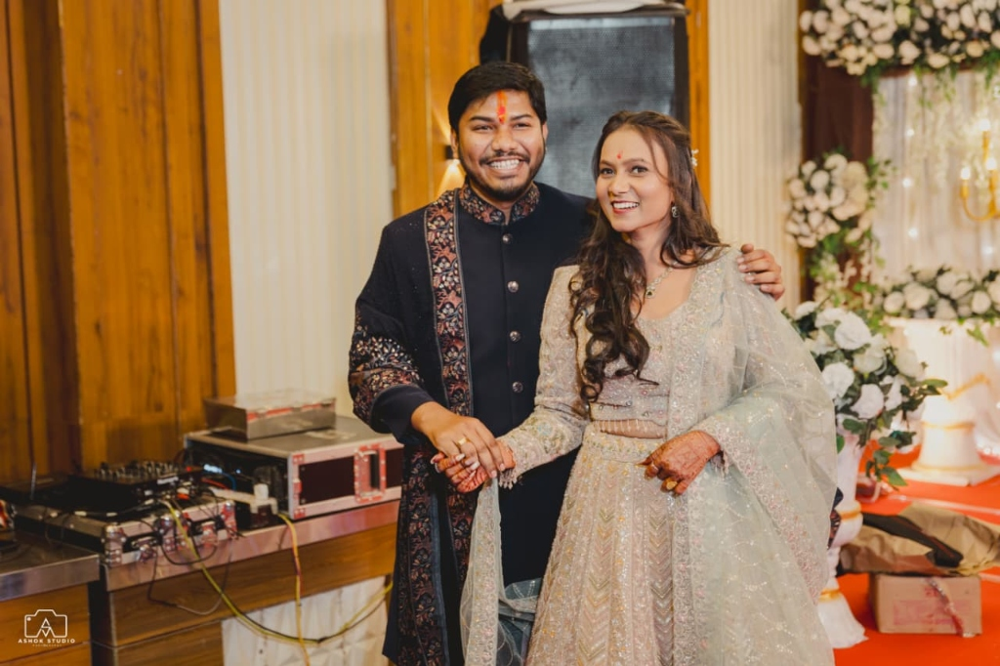

# 🌺 रश्मि संग अर्पित | Rashmi & Arpit Wedding Invitation Website

A luxury, interactive digital wedding invitation website built with **React 19**, **Vite**, and **Tailwind CSS**, celebrating the union of **Rashmi Thakur & Arpit Maravi**.



---

## ✨ Features

- 🎭 **Two Handcrafted Designer Themes:**
  - **Royal Udaipur Palace (Template 1):** Envelope wax seal reveal, monumental 26 Nov 2026 countdown plaque, regal burgundy & gold aesthetics, Shehnai audio, and RSVP modal.
  - **Classic Marigold & Toran (Template 2):** Auspicious marigold garland header, floating petal animations, interactive *"पुष्प वर्षा"* (Pushpa Varsha) petal shower, symmetric ceremony schedule cards, and couple photo gallery with lightbox.
- 🎵 **Wedding Music Experience:** Seamless background playback of *"Aaj Sajeya"* (Goldie Sohel) with Web Audio API harmonic drone fallback.
- 📍 **One-Click Venue Navigation:** Direct Google Maps links for Jabera ceremonies and Jabalpur Marriage Garden.
- 📱 **100% Mobile & Tablet Responsive:** Optimized typography, touch-friendly audio controls, and fluid responsive grids.
- 💬 **WhatsApp Ready:** Full OpenGraph preview meta tags configured with title, description, and preview image for WhatsApp sharing.

---

## 🗓️ Auspicious Wedding Schedule (मांगलिक कार्यक्रम)

| तिथि (Date) | समय (Time) | कार्यक्रम (Ceremony) | स्थान (Venue) |
|---|---|---|---|
| **24 नवम्बर 2026 (मंगलवार)** | 02:00 PM से | **मेहंदी उत्सव (Mehendi Ceremony)** | निज निवास, जबेरा (दमोह) |
| **25 नवम्बर 2026 (बुधवार)** | 12:00 PM से | **मण्डपाच्छादन एवं हल्दी (Mandap & Haldi)** | निज निवास, जबेरा (दमोह) |
| **26 नवम्बर 2026 (गुरूवार)** | 10:00 AM | **जबेरा से जबलपुर प्रस्थान** (बस द्वारा) | जबेरा ➔ जबलपुर |
| **26 नवम्बर 2026 (गुरूवार)** | 07:00 PM से | **मुख्य विवाह, पाणिग्रहण (सात फेरे) एवं प्रीतिभोज** | रिद्धि-सिद्धि मैरिज गार्डन, पाटन बाईपास के पास, जबलपुर |

---

## 🚀 Quick Start (Local Development)

```bash
# Clone the repository
git clone https://github.com/sourabh-dhangar/rashmi-arpit-wedding-invitation.git

# Navigate to project directory
cd rashmi-arpit-wedding-invitation

# Install dependencies
npm install

# Start local development server
npm run dev
```

Open `http://localhost:5173` in your browser.

---

## 📦 Build for Production

```bash
npm run build
```

The output will be placed in the `dist/` directory, ready to deploy to Vercel, Netlify, or GitHub Pages.

---

## 🌐 Deployment on Vercel

1. Import the repository `sourabh-dhangar/rashmi-arpit-wedding-invitation` into [Vercel](https://vercel.com).
2. Framework Preset: **Vite**
3. Build Command: `npm run build`
4. Output Directory: `dist`
5. Click **Deploy**!

---

*With best compliments from Thakur & Maravi Family.* 🌸
